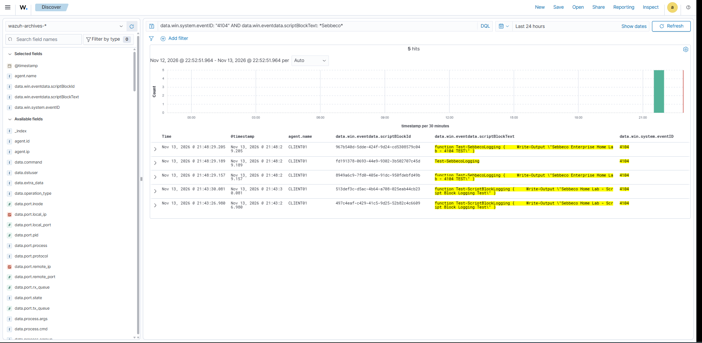

# Security Monitoring

## Overview

Security monitoring is an important part of maintaining a secure IT environment.

The goal of this section is to expand the Sebbeco Enterprise Home Lab with tools and techniques for detecting suspicious activity, investigating security events and monitoring endpoints.

The lab uses Wazuh as its centralized security monitoring platform, combined with Sysmon and Windows event logging to provide visibility into endpoint activity.

## Current Security Measures

The lab currently includes:

- Active Directory Domain Services for centralized identity management.
- Individual domain user accounts.
- Department-based Organizational Units.
- An IT-Support security group.
- Group Policy enforcing screen saver security for HR users.
- Group Policy enabling PowerShell Script Block Logging.
- An isolated virtual network.
- Wazuh agent installed on the Windows 11 client.

## Wazuh SIEM Deployment

Wazuh has been deployed on Ubuntu Server 24.04.5 as an all-in-one installation.

The deployment includes:

- Wazuh Manager – Centralized event collection and analysis.
- Wazuh Indexer – Storage and indexing of security events.
- Wazuh Dashboard – Web interface for monitoring and investigation.

The Windows 11 client (CLIENT01) is connected to the Wazuh Manager and successfully forwards security events.

### Log Collection

The Wazuh agent collects multiple Windows event channels, including:

- Application
- Security
- System
- Microsoft-Windows-Sysmon/Operational
- Microsoft-Windows-PowerShell/Operational

Raw JSON event archiving is enabled on the Wazuh Manager, allowing collected events to be stored and investigated.

An index pattern (`wazuh-archives-*`) has been configured in Wazuh Dashboard to make archived events searchable through Discover.

## Sysmon Integration

Sysmon has been installed on CLIENT01 to provide detailed endpoint telemetry.

The following event types have been verified:

| Event ID | Description |
|---|---|
| 1 | Process creation |
| 3 | Network connection |
| 5 | Process termination |
| 11 | File creation |

These events provide visibility into process execution, parent-child process relationships and network activity.

## PowerShell Script Block Logging

PowerShell Script Block Logging has been enabled through Group Policy.

The configuration collects Windows PowerShell Operational events, particularly Event ID 4104.

Event ID 4104 records PowerShell script block contents, allowing investigation of commands and scripts processed by PowerShell.

The integration has been verified by:

- Enabling Script Block Logging through Group Policy.
- Confirming the policy was applied on CLIENT01.
- Generating test PowerShell scripts.
- Confirming Event ID 4104 locally in Windows Event Viewer.
- Verifying that Wazuh receives and archives the events.
- Searching for script contents in Wazuh Discover.

### Screenshot

The screenshot demonstrates centralized collection and investigation of PowerShell Script Block Logging events (Event ID 4104) from CLIENT01.

## Security Investigation Exercises

Initial investigation exercises have been performed using the collected telemetry.

Topics covered include:

- Investigating process creation and parent-child relationships.
- Identifying PowerShell execution through Sysmon Event ID 1.
- Examining PowerShell script contents through Event ID 4104.
- Investigating network connections through Sysmon Event ID 3.
- Correlating process activity with network events.
- Identifying potentially suspicious PowerShell execution patterns.
- Distinguishing suspicious activity from confirmed malicious behaviour.

All currently performed tests have used controlled, benign activity within the isolated lab environment.

## Planned Improvements

| Improvement | Purpose |
|---|---|
| Windows Defender monitoring | Improve endpoint security visibility |
| PowerShell Module Logging | Collect additional PowerShell execution details |
| Windows Security Event Analysis | Investigate authentication and account activity |
| Nmap | Network discovery and service enumeration |
| Advanced Wazuh Rules | Improve detection of suspicious activity |
| Additional SOC Exercises | Practice incident investigation and event correlation |

## Learning Objectives

- Understand endpoint monitoring and telemetry.
- Learn Windows security logging.
- Develop practical SIEM skills.
- Investigate process execution and network activity.
- Understand common attack techniques and detection methods.
- Practice incident analysis and evidence-based conclusions.

## Project Status

The initial security monitoring environment has been implemented and verified.

Wazuh, Sysmon and PowerShell Script Block Logging are operational, with events successfully collected from CLIENT01 and searchable through Wazuh Dashboard.

Further detection engineering, monitoring improvements and SOC investigation exercises remain ongoing.
